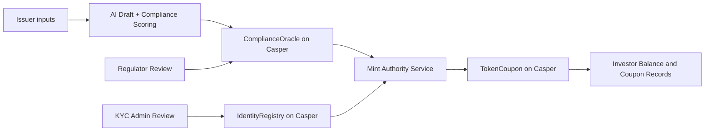

# NexusRWA

End-to-end AI-assisted RWA issuance workflow on Casper Testnet, with compliance scoring, identity gating, and coupon lifecycle recorded through Casper smart contracts.


## Submission Readiness (DoraHacks)

| Requirement | Status | Evidence |
|---|---|---|
| Working prototype on Casper Testnet with transaction-producing on-chain component | Complete | Deploy record in `app/data/deployments.json` and explorer link below |
| Open-source repository with README and usage instructions | Complete | This repository + setup/run steps below |
| Public demo video | Pending link update | Add final public URL in Demo section |

## What This Project Does

NexusRWA is a full workflow for regulated-style token issuance:

1. AI drafts offering content from issuer inputs.
2. AI scores the submission against SFC-oriented rules.
3. Compliance score evidence is anchored to Casper via `ComplianceOracle`.
4. Regulator and KYC admin remain human-in-the-loop.
5. Minting/subscription flows are executed by authorized mint authority on Casper.
6. Coupon metadata and investor balances are recorded on-chain.

This repository focuses on a working Casper prototype for the buildathon round.

## Judge Quick Proof (3-5 Minute Scan)

### 1) Casper On-Chain Deployment Proof

Source of truth: `app/data/deployments.json`

| Item | Value |
|---|---|
| Network | Casper Testnet |
| Deploy hash | `4c3df0d87420700ab312597e0c5d3c01081963b074d16c8dffe7074600c76556` |
| Explorer | https://testnet.cspr.live/deploy/4c3df0d87420700ab312597e0c5d3c01081963b074d16c8dffe7074600c76556 |
| Contract hash | `contract-5433399954f15e10c02ee6064fe28ac1c7fefafd5d05b9e9728b585c30fd0fa1` |
| Asset id | `nibt2` |
| Standard | Casper Token/Coupon WASM |

### 2) Smart Contracts Implemented in Rust/Odra

- `app/contracts-casper/compliance-oracle/src/lib.rs`
  - `submit_score(asset_id, score, report_hash)`
  - `get_score(asset_id)`
  - `is_compliant(asset_id, threshold)`
- `app/contracts-casper/identity-registry/src/lib.rs`
  - `upsert_investor(...)`
  - `is_eligible(investor)`
  - `revoke_investor(investor)`
- `app/contracts-casper/token-coupon/src/lib.rs`
  - `init(...)`
  - `mint_to(...)`, `subscribe(...)`, `settle_purchase(...)`
  - `record_coupon(...)`
  - `balance_of(...)`, `get_coupon(...)`, `get_metadata()`

### 3) Compliance Ruleset in Repository

- Rule source: `app/compliance-rules/sfc-rules.json`
- Includes core SFC rules plus asset-class extensions (bond, trade receivable, green bond, REIT).
- The bond demo corpus is provided in `app/test/HIBT-Prospectus.txt`.

## Architecture



## Agentic + Human-in-the-Loop Model

- AI is used for drafting, document analysis, and scoring assistance.
- Regulator and KYC admin remain explicit decision makers.
- Casper contracts store key issuance and lifecycle state.
- Minting is protected by authorization (`owner` or `mint_authority`) at the contract level.

Note: In this buildathon prototype, some compliance gating is performed by authorized service logic that writes/executes on Casper, rather than all checks being embedded as direct cross-contract calls inside `token-coupon`.

## Application Routes

UI routes under `app/src/app`:

- `/prospectus`
- `/tokenize`
- `/compliance`
- `/audit`
- `/regulator`
- `/kyc`
- `/admin/kyc`
- `/subscribe`
- `/portfolio`

API routes under `app/src/app/api` include:

- `/api/tokenize/*`
- `/api/compliance/*`
- `/api/kyc/*`
- `/api/subscribe/*`
- `/api/portfolio/*`
- `/api/audit/*`
- `/api/advisor/*`

## Technology Stack

- Frontend: Next.js, React, TypeScript, Tailwind CSS
- Casper contracts: Rust + Odra + WASM
- EVM fallback contracts (secondary path): Solidity + Hardhat
- AI layer: OpenAI-compatible provider and rule-based scoring pipeline
- Data artifacts: local JSON registries in `app/data`

## Quick Start

```bash
git clone <repo>
cd casper-agentic-buildathon/app
npm install
npm run dev
```

Open: http://localhost:3000

## Environment

Create `app/.env.local`:

```env
CASPER_CHAIN_NAME=casper-test
CASPER_RPC_URL=https://rpc.testnet.casperlabs.io
CASPER_DEPLOY_TIMEOUT_MS=300000

CASPER_ORACLE_KEY=<ed25519-private-key-hex>
CASPER_ORACLE_PUBLIC_KEY=<ed25519-public-key-hex>
CASPER_TREASURY_PUBLIC_KEY=<ed25519-public-key-hex>

SILICONFLOW_API_KEY=<api-key>
# or
OPENAI_API_KEY=<api-key>
```

## Build Casper WASM Contracts

```bash
cargo install cargo-odra --locked
cd app/contracts-casper/compliance-oracle && cargo odra build -b casper
cd app/contracts-casper/identity-registry && cargo odra build -b casper
cd app/contracts-casper/token-coupon && cargo odra build -b casper
```

## Deploy to Casper Testnet (PowerShell)

```powershell
.\deploy-casper-contracts.ps1 -AccountKey <ed25519-hex> -PublicKey <pub-hex>
```

Testnet faucet: https://testnet.cspr.live/tools/faucet

## Reproducible Evidence Commands

From repository root:

```powershell
node test-subscribe.mjs
node test-payment-verification.mjs
node test-mint-error.mjs
```

From `app` directory:

```powershell
node test-deploy-server.cjs
```

## How This README Maps to DoraHacks Judging

| Judging dimension | Where to evaluate in this repo |
|---|---|
| Technical Execution | Casper contracts in `app/contracts-casper`, API flows in `app/src/app/api` |
| Innovation and Originality | AI scoring + on-chain compliance anchoring workflow |
| Use of AI / Agentic Systems | Drafting/scoring/advisor flows in UI + API route design |
| Real-World Applicability | SFC-oriented rules in `app/compliance-rules/sfc-rules.json`, bond corpus in `app/test/HIBT-Prospectus.txt` |
| UX and Product Design | End-user pages under `app/src/app/*` |
| Working Smart Contracts | Testnet deploy record in `app/data/deployments.json` + explorer URL |
| Long-Term Launch Plan | Roadmap below |

## Roadmap

### Next 3 Months

- Harden Casper deployment reliability and monitoring.
- Add deterministic verification script for AI report hash to reduce trust assumptions.
- Improve judge-facing demo automation for full issuance walkthrough.

### Next 6-12 Months

- Expand jurisdictional rule packs (beyond current SFC-focused set).
- Increase automation for compliance lifecycle events with stricter controls.
- Package the workflow as compliance tooling for institutional issuers.

## Repository Structure

```text
app/
  compliance-rules/
    sfc-rules.json
  contracts-casper/
    compliance-oracle/
    identity-registry/
    token-coupon/
  data/
    deployments.json
    kyc-inbox.json
    sfc-inbox.json
  src/
    app/
    lib/
```

## Notes for Final Submission

- Replace demo video placeholder with public URL.
- Keep deploy hashes in this README synchronized with `app/data/deployments.json`.
- If new deploy is used in final demo, update both this README and explorer links together.

## License

MIT